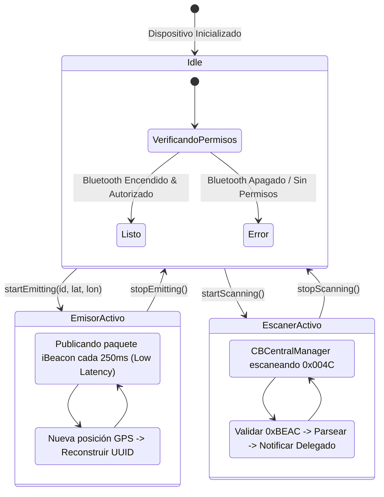

# Especificación Técnica: Protocolo de Hardware BLE (iBeacon Antigravity)

Esta especificación describe el protocolo de comunicación por radiofrecuencia Bluetooth Low Energy (BLE) utilizado entre senderistas para compartir su posición geográfica, identificación y telemetría sin depender de conexión a internet o red celular.

---

## 1. Arquitectura del Paquete de Publicidad (Advertising Packet)

La aplicación emite paquetes de tipo **Apple Manufacturer Specific Data** compatibles con el estándar de facto **iBeacon**.

* **Company Identifier:** `0x004C` (Apple Inc. en Little-Endian en el encabezado HCI: `4C 00`)
* **Beacon Type Code:** `0x02` (iBeacon)
* **Remaining Payload Length:** `0x15` (21 bytes)

```
+---------------+---------------+---------------------------------------+---------------+---------------+---------------+
| Type (1 byte) | Length (1 B)  | Proximity UUID (16 bytes)             | Major (2 B)   | Minor (2 B)   | TxPower (1 B) |
| 0x02          | 0x15 (21)     | [Estructura personalizada de 16 B]     | 0x00 0x01     | 0x00 0x01     | 0xC5 (-59 dBm)|
+---------------+---------------+---------------------------------------+---------------+---------------+---------------+
```

---

## 2. Estructura de Bytes del Proximity UUID (16 Bytes)

En lugar de un UUID estático convencional, los 16 bytes del Proximity UUID se particionan para transmitir la posición GPS en vivo y el identificador de la baliza:

| Rango de Bytes | Tamaño | Tipo de Dato | Descripción | Ejemplo / Representación |
| :--- | :--- | :--- | :--- | :--- |
| **Bytes 0 .. 5** | 6 bytes | Raw Bytes / Hex String | `idBeacon`: Identificador único del dispositivo emisor (12 caracteres hexadecimales). | `[0x8C, 0x3A, 0x9F, 0x21, 0xB7, 0x6E]` -> `"8c3a9f21b76e"` |
| **Bytes 6 .. 9** | 4 bytes | IEEE 754 Float (Big-Endian) | `Latitud`: Coordenada de latitud del emisor (precisión ~1 metro). | `19.2458f` -> `0x41 0x99 0xF7 0xCE` |
| **Bytes 10 .. 13** | 4 bytes | IEEE 754 Float (Big-Endian) | `Longitud`: Coordenada de longitud del emisor. | `-103.7251f` -> `0xC2 0xCF 0x73 0x3E` |
| **Bytes 14 .. 15** | 2 bytes | Constante Mágica | **Magic Signature:** `0xBE 0xAC`. Permite al receptor filtrar y validar que el paquete proviene de la app y no de un iBeacon comercial ajeno. | `0xBE 0xAC` |

---

## 3. Campos Major, Minor y Tx Power

| Campo | Offset | Tamaño | Valor / Función |
| :--- | :--- | :--- | :--- |
| **Major** | Bytes 18 .. 19 | 2 bytes (uint16_t) | Default: `1` (Reservado para ID de grupo / evento). |
| **Minor** | Bytes 20 .. 21 | 2 bytes (uint16_t) | Default: `1` (O identificador numérico de senderista). |
| **Tx Power** | Byte 22 | 1 byte (int8_t con signo) | `-59` dBm (Potencia calibrada medida a 1 metro de distancia). |

---

## 4. Algoritmo de Estimación de Distancia por RSSI

Para calcular la distancia aproximada en metros entre dos dispositivos a partir de la señal RSSI recibida:

```swift
func calcularDistanciaMetros(rssi: Int, txPower: Int = -59) -> Double {
    if rssi == 0 { return -1.0 }
    
    let ratio = Double(rssi) / Double(txPower)
    if ratio < 1.0 {
        return pow(ratio, 10.0)
    } else {
        // Modelo Log-Distance Path Loss (n = 2.0 a 2.5 en campo abierto)
        return (0.89976) * pow(ratio, 7.7095) + 0.111
    }
}
```

---

## 5. Implementación Nativa en Swift (CoreBluetooth)

### Decodificador de Paquete en Swift:
```swift
import Foundation

struct BeaconPayload {
    let idBeacon: String
    let latitude: Double
    let longitude: Double
    let major: Int
    let minor: Int
    let txPower: Int

    static func parse(manufacturerData: Data) -> BeaconPayload? {
        // Esperamos 23 bytes (después del company identifier 0x004C)
        guard manufacturerData.count >= 23 else { return nil }
        guard manufacturerData[0] == 0x02 && manufacturerData[1] == 0x15 else { return nil }
        
        // Validar firma mágica en bytes 16 y 17 (offset dentro de manufacturerData)
        guard manufacturerData[16] == 0xBE && manufacturerData[17] == 0xAC else { return nil }

        // 1. idBeacon (bytes 2..7)
        let idBytes = manufacturerData.subdata(in: 2..<8)
        let idBeacon = idBytes.map { String(format: "%02x", $0) }.joined()

        // 2. Latitud (bytes 8..11, Float32 Big-Endian)
        let latBits = manufacturerData.subdata(in: 8..<12).withUnsafeBytes { $0.load(as: UInt32.self).bigEndian }
        let latitude = Double(Float(bitPattern: latBits))

        // 3. Longitud (bytes 12..15, Float32 Big-Endian)
        let lonBits = manufacturerData.subdata(in: 12..<16).withUnsafeBytes { $0.load(as: UInt32.self).bigEndian }
        let longitude = Double(Float(bitPattern: lonBits))

        // 4. Major (bytes 18..19) & Minor (bytes 20..21)
        let major = Int(manufacturerData[18]) << 8 | Int(manufacturerData[19])
        let minor = Int(manufacturerData[20]) << 8 | Int(manufacturerData[21])
        
        // 5. Tx Power (byte 22)
        let txPower = Int(Int8(bitPattern: manufacturerData[22]))

        return BeaconPayload(
            idBeacon: idBeacon,
            latitude: latitude,
            longitude: longitude,
            major: major,
            minor: minor,
            txPower: txPower
        )
    }
}
```

---

## 6. Máquina de Estados del Hardware BLE


